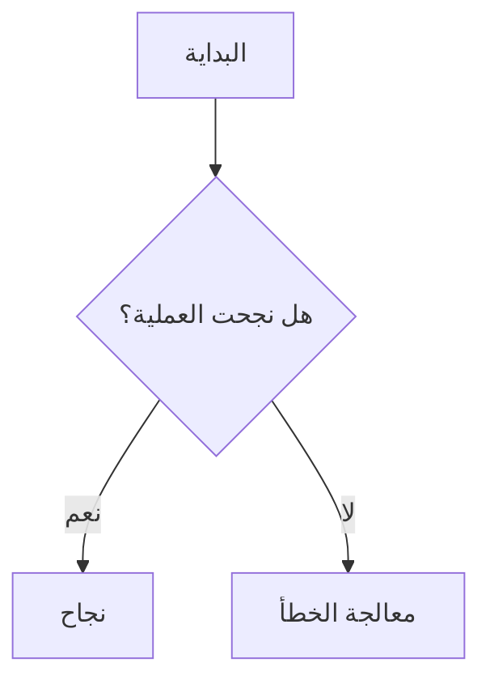
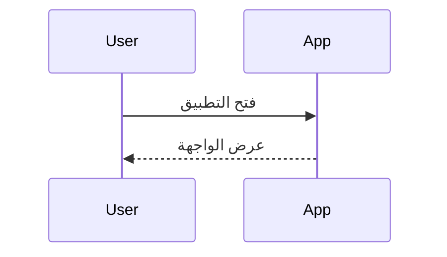

# دليل Markdown الشامل — Cheat Sheet

مرجع عملي لكتابة ملفات `.md` و`.markdown`، مع أمثلة جاهزة للنسخ.

> **ملاحظة:** Markdown لغة ترميز خفيفة، وليست HTML أو CSS. تختلف بعض الإضافات حسب التطبيق الذي يعرض الملف؛ لذلك قد تعمل صيغة في GitHub ولا تعمل في عارض Markdown آخر.

---

## 1. العناوين — Headings

استخدم علامة `#` قبل نص العنوان، مع مسافة بعدها:

```md
# عنوان المستوى الأول H1
## عنوان المستوى الثاني H2
### عنوان المستوى الثالث H3
#### عنوان المستوى الرابع H4
##### عنوان المستوى الخامس H5
###### عنوان المستوى السادس H6
```

ويمكن استخدام أسلوب العناوين البديل للعناوين الرئيسية والفرعية:

```md
عنوان رئيسي
============

عنوان فرعي
----------
```

---

## 2. تنسيق النص — Text Formatting

| النتيجة | الصيغة |
|---|---|
| **غامق** | `**نص غامق**` أو `__نص غامق__` |
| *مائل* | `*نص مائل*` أو `_نص مائل_` |
| ***غامق ومائل*** | `***نص غامق ومائل***` |
| ~~يتوسطه خط~~ | `~~نص محذوف~~` |
| نص `برمجي داخل السطر` | `` `كود` `` |
| نص عادي | `نص عادي` |

مثال:

```md
**مهم:** هذا نص غامق.

*تنبيه:* هذا نص مائل.

***مهم جدًا:*** غامق ومائل.

~~معلومة قديمة~~ معلومة محدّثة.

استخدم الأمر `ipconfig` لعرض إعدادات الشبكة.
```

### إبراز النص أو تمييزه

صيغة التمييز التالية ليست جزءًا من CommonMark القياسي، لكنها مدعومة في بعض المحررات:

```md
==نص مميز==
```

---

## 3. الفقرات والأسطر — Paragraphs & Line Breaks

افصل بين الفقرات بسطر فارغ:

```md
هذه هي الفقرة الأولى.

هذه هي الفقرة الثانية.
```

لإجبار النص على الانتقال إلى سطر جديد داخل الفقرة، ضع مسافتين في نهاية السطر أو استخدم `<br>`:

```md
السطر الأول  
السطر الثاني

أو:
السطر الأول<br>
السطر الثاني
```

---

## 4. الاقتباسات — Blockquotes

استخدم `>` في بداية السطر:

```md
> هذا اقتباس.
>
> يمكن أن يتكون الاقتباس من عدة أسطر.
>> ويمكن إدراج اقتباس متداخل.
```

يمكن وضع تنسيقات Markdown داخل الاقتباس:

```md
> **ملاحظة:** انتبه إلى هذه النقطة.
>
> - عنصر أول
> - عنصر ثانٍ
```

---

## 5. القوائم — Lists

### قائمة غير مرتبة

يمكن استخدام `-` أو `*` أو `+`:

```md
- عنصر أول
- عنصر ثانٍ
  - عنصر فرعي
  - عنصر فرعي آخر
- عنصر ثالث
```

### قائمة مرتبة

```md
1. الخطوة الأولى
2. الخطوة الثانية
   1. خطوة فرعية
   2. خطوة فرعية أخرى
3. الخطوة الثالثة
```

يمكن كتابة الرقم نفسه لكل العناصر، وسيعيد العارض ترتيبها غالبًا:

```md
1. الأول
1. الثاني
1. الثالث
```

### قائمة مهام — Task List

مدعومة في GitHub وعدد من المحررات:

```md
- [ ] مهمة غير مكتملة
- [x] مهمة مكتملة
- [ ] مهمة أخرى
```

---

## 6. الخطوط الفاصلة — Horizontal Rules

اكتب ثلاثة رموز أو أكثر من النوع نفسه في سطر مستقل:

```md
---

***

___
```

---

## 7. الروابط — Links

### رابط نصي

```md
[اسم الرابط](https://example.com)
```

### رابط مع عنوان توضيحي يظهر عند تمرير المؤشر

```md
[موقع تجريبي](https://example.com "عنوان توضيحي")
```

### رابط مرجعي — Reference Link

```md
راجع [دليل Markdown][markdown-guide].

[markdown-guide]: https://www.markdownguide.org/ "Markdown Guide"
```

### رابط إلى عنوان داخل الملف

```md
[انتقل إلى قسم القوائم](#القوائم--lists)
```

تختلف طريقة إنشاء المعرّف الداخلي للعناوين حسب العارض، خصوصًا مع العربية وعلامات الترقيم.

### رابط تلقائي

```md
https://example.com
<https://example.com>
<name@example.com>
```

---

## 8. الصور — Images

### صورة من رابط خارجي

```md

```

### صورة محلية داخل المشروع

```md

```

### صورة مع عنوان توضيحي

```md

```

> المسارات المحلية تكون عادةً نسبية إلى موقع ملف Markdown. دعم تغيير حجم الصورة ومحاذاتها ليس موحدًا في Markdown القياسي.

---

## 9. الأكواد — Code

### كود داخل السطر — Inline Code

ضع النص أو الأمر بين علامتي backtick:

```md
نفّذ الأمر `dir /s` لعرض الملفات والمجلدات.
```

### كتلة كود — Fenced Code Block

ضع ثلاثة backticks قبل الكود وبعده:

````md
```
هذا كود دون تحديد اللغة.
```
````

### كتلة كود مع تحديد اللغة — Syntax Highlighting

اكتب اسم اللغة مباشرة بعد backticks الافتتاحية:

````md
```js
function greet(name) {
  return `Hello, ${name}!`;
}
```

```python
print("Hello, world!")
```

```html
<h1>Hello</h1>
```

```css
body {
  margin: 0;
}
```

```json
{
  "name": "My App",
  "version": "1.0.0"
}
```

```bash
 echo "Hello"
```

```powershell
Get-ChildItem
```

```csharp
Console.WriteLine("Hello");
```

```sql
SELECT * FROM users;
```
````

لغات شائعة للتلوين: `text`، `bash`، `shell`، `powershell`، `cmd`، `js`، `ts`، `html`، `css`، `json`، `yaml`، `xml`، `python`، `csharp`، `java`، `sql`، `php`، `go`، `rust`، `diff`، `markdown`.

### إظهار علامات Markdown حرفيًا

استخدم backslash قبل الرمز كي لا يفسّره العارض:

```md
\*هذا ليس نصًا مائلًا\*
\# هذا ليس عنوانًا
\- هذا ليس عنصر قائمة
```

### كتل كود متداخلة

إذا كان المثال يحتوي على ثلاثة backticks، افتح وأغلق الكتلة الخارجية بأربعة backticks أو أكثر:

````md
````js
console.log("Example");
````
````

---

## 10. الجداول — Tables

صيغة الجداول شائعة في GitHub Flavored Markdown (GFM)، لكنها ليست ضمن CommonMark الأساسي:

```md
| الاسم | الوظيفة | الحالة |
|---|---|---|
| أحمد | مدير | نشط |
| سارة | محاسبة | نشط |
| علي | تقني | متوقف |
```

### محاذاة أعمدة الجدول

```md
| يسار | وسط | يمين |
|:---|:---:|---:|
| A | B | C |
| 10 | 20 | 30 |
```

- `:---` محاذاة إلى اليسار.
- `:---:` محاذاة إلى الوسط.
- `---:` محاذاة إلى اليمين.

### وضع رمز `|` داخل خلية

```md
| التعبير | المعنى |
|---|---|
| A \| B | أحد الخيارين |
```

---

## 11. أحرف خاصة ورموز تحتاج إلى Escape

ضع `\` قبل الرمز كي يظهر كما هو بدل تفسيره كتنسيق:

```md
\* نجمة
\_ شرطة سفلية
\# علامة عنوان
\+ زائد
\- ناقص
\. نقطة
\! تعجب
\[ قوس مربع مفتوح
\] قوس مربع مغلق
\( قوس دائري مفتوح
\) قوس دائري مغلق
\> علامة اقتباس
\` backtick
\\ backslash
```

أمثلة مهمة:

```md
السعر: 10\$  (يعتمد ظهور الشرطة العكسية على السياق)
اكتب \# داخل النص لإظهار علامة #.
```

---

## 12. HTML داخل Markdown

تسمح عوارض كثيرة بإدراج HTML داخل ملف Markdown، لكن الدعم يختلف وقد تُحذف بعض الوسوم لأسباب أمنية:

```html
<br>
<strong>نص غامق</strong>
<em>نص مائل</em>
<details>
  <summary>اضغط لعرض التفاصيل</summary>
  هذا محتوى قابل للطي.
</details>
```

مثال على محاذاة محتوى باستخدام HTML:

```html
<p align="center">
  <strong>عنوان في الوسط</strong>
</p>
```

> لا تفترض أن CSS أو JavaScript أو جميع خصائص HTML ستعمل داخل ملفات Markdown؛ كثير من المنصات تمنعها أو تتجاهلها.

---

## 13. ملاحظات وتنبيهات GitHub

GitHub يدعم كتل التنبيه التالية داخل الاقتباس:

```md
> [!NOTE]
> معلومة مفيدة.

> [!TIP]
> نصيحة تساعد على إنجاز المهمة.

> [!IMPORTANT]
> معلومة أساسية.

> [!WARNING]
> تحذير من مشكلة محتملة.

> [!CAUTION]
> تنبيه من إجراء قد يسبب ضررًا.
```

هذه الصيغة خاصة بمنصات تدعم GitHub Flavored Markdown، وليست مضمونة في جميع العوارض.

---

## 14. الشطب والروابط التلقائية في GFM

```md
~~نص مشطوب~~

https://github.com

www.example.com
```

دعم الروابط التلقائية يختلف بين المحررات؛ صيغة الرابط الصريحة `[النص](الرابط)` أكثر قابلية للنقل.

---

## 15. المعادلات الرياضية — Math / LaTeX

ليست جزءًا من Markdown الأساسي، لكنها مدعومة في عوارض مثل بعض إعدادات GitHub وObsidian وJupyter وغيرها:

```md
معادلة داخل السطر: $E = mc^2$

معادلة مستقلة:
$$
\frac{a}{b} = c
$$
```

قد تختلف طريقة التفعيل والدعم حسب التطبيق.

---

## 16. الحواشي السفلية — Footnotes

مدعومة في بعض امتدادات Markdown، ومنها GFM:

```md
هذه جملة تتضمن حاشية.[^1]

[^1]: هذا نص الحاشية السفلية.
```

---

## 17. مخططات Mermaid

تعمل في العوارض التي تدمج Mermaid، مثل GitHub وبعض أدوات التوثيق:

````md

````

مثال مخطط تسلسلي:

````md

````

---

## 18. رموز Emoji

يمكن إدراج الرموز مباشرةً:

```md
✅ مكتمل
⚠️ تحذير
❌ فشل
📌 ملاحظة
🚀 إطلاق
```

وتدعم بعض المنصات أسماء الرموز المختصرة، مثل:

```md
:smile: :warning: :rocket:
```

لكن هذه الأسماء ليست قياسية في جميع المحررات.

---

## 19. التعليقات — Comments

لا توجد صيغة تعليقات موحدة في Markdown. يمكن استخدام تعليق HTML في العوارض التي لا تزيله:

```md
<!-- هذا تعليق لن يظهر عادةً في العرض النهائي -->
```

---

## 20. بيانات Front Matter

تستخدم بعض أنظمة التوثيق والمدونات بيانات YAML في أعلى الملف. هذه ليست جزءًا من Markdown القياسي:

```yaml
---
title: عنوان المستند
description: وصف مختصر
author: Mohammed
date: 2026-10-30
tags:
  - Markdown
  - Documentation
---
```


---

## 21. قوالب جاهزة لملف Markdown

### قالب مستند عام

```md
# عنوان المستند

> وصف مختصر لهدف المستند.

## 1. المقدمة

اكتب المقدمة هنا.

## 2. التفاصيل

### 2.1 عنوان فرعي

- نقطة أولى.
- نقطة ثانية.

## 3. الإجراءات

1. الخطوة الأولى.
2. الخطوة الثانية.

## 4. ملاحظات

> [!NOTE]
> أضف ملاحظة مهمة هنا.

## 5. المراجع

- [مرجع أول](https://example.com)

---

آخر تحديث: 30/10/2026
```

### قالب README لمشروع برمجي

````md
# Project Name

وصف موجز للمشروع وما الذي يقدمه.

## Features

- ميزة أولى.
- ميزة ثانية.

## Requirements

- Windows 10 أو أحدث.

## Installation

```powershell
.\build.ps1
```

## Usage

اشرح طريقة الاستخدام.

## Configuration

اشرح ملفات الإعدادات وخياراتها.

## Troubleshooting

اذكر المشكلات الشائعة وحلولها.

## License

اذكر الترخيص.
```

---

## 22. قواعد مهمة لتفادي أخطاء Markdown

1. اترك مسافة بعد `#` في العناوين: اكتب `# عنوان` لا `#عنوان`.
2. اترك سطرًا فارغًا قبل القوائم والجداول وكتل الأكواد وبعدها عند الحاجة.
3. استخدم ثلاثة backticks لفتح كتلة الكود وإغلاقها، وتأكد من عدم نسيان الإغلاق.
4. أضف اسم اللغة بعد backticks لتمييز ألوان الكود.
5. لا تضع مسافات عشوائية قبل عناصر القائمة؛ استخدم مسافتين أو أربعًا بشكل ثابت للعناصر الفرعية.
6. استخدم مسارات نسبية للصور والملفات المرفقة كي يعمل المستند بعد نقله مع مجلد المشروع.
7. لا تعتمد على HTML أو Mermaid أو Math أو التنبيهات الخاصة إذا كان الملف سيُعرض في عارض غير معروف.
8. اختبر الملف في العارض المستهدف؛ فملف Markdown نفسه لا يحدد الخطوط أو الألوان أو الهوامش أو تصميم الصفحة.

---

## 23. الفرق بين أشهر صيغ Markdown

| الصيغة | الوصف |
|---|---|
| Markdown الأصلي | الصيغة الأساسية التي اشتهرت مع John Gruber. |
| CommonMark | مواصفة أكثر تحديدًا لتوحيد تفسير Markdown الأساسي. |
| GitHub Flavored Markdown (GFM) | امتداد يضيف الجداول وقوائم المهام والشطب والروابط التلقائية وغيرها. |
| Markdown في Obsidian | يدعم إضافات مثل الروابط الداخلية والخصائص والكتل القابلة للطي بحسب التطبيق. |
| Markdown في MkDocs / Docusaurus | يعتمد على CommonMark أو إضافات وملحقات خاصة بنظام التوثيق. |

**الخلاصة:** عند إعداد ملف قابل للنقل بين التطبيقات، التزم بالعناوين والفقرات والقوائم والاقتباسات والروابط والصور وكتل الأكواد. واستخدم الإضافات الخاصة فقط عندما تعرف أن العارض المستهدف يدعمها.

## مراجع مفيدة

- [Markdown Guide](https://www.markdownguide.org/)
- [CommonMark Specification](https://spec.commonmark.org/)
- [GitHub Flavored Markdown Spec](https://github.github.com/gfm/)
- [GitHub: Basic writing and formatting syntax](https://docs.github.com/en/get-started/writing-on-github)
